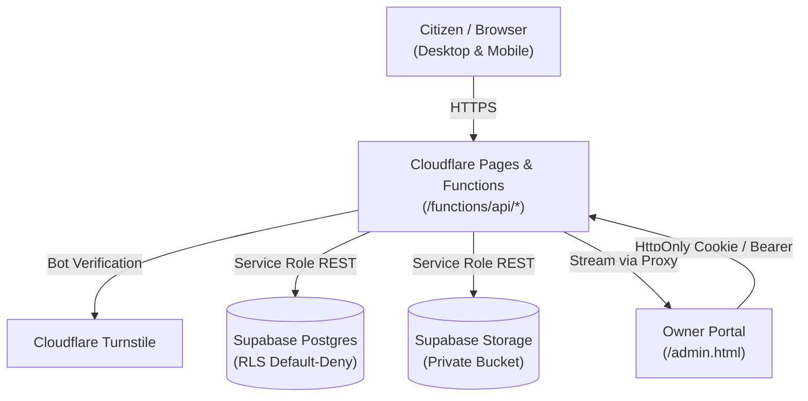

# Digital Seva

<div align="center">

**Citizen Application Assistance & Documentation Platform**

A modern, privacy-first web application providing guided documentation checklists, bilingual assistance (English and Kannada), and secure document submission for essential civic services.

[](LICENSE)
[](https://nodejs.org/)
[](https://pages.cloudflare.com/)
[](https://supabase.com/)
[](tests/test_suite.js)

[Live Website](https://digital-seva-website.pages.dev/) • [Owner Portal](https://digital-seva-website.pages.dev/admin.html)

</div>

---

## Overview

**Digital Seva** is an independent citizen facilitation initiative based in Karnataka. The platform helps applicants navigate complex government portals—including PAN, Voter ID, Aadhaar, Passport, certificates, and scholarships—by providing clear eligibility guidelines, document requirements, and remote assistance from home.

When viewing any service, citizens are presented with two distinct paths:

1. **Option A — Contact via WhatsApp**: Direct one-on-one coordination with a representative (+91 8660847792), including prefilled service and variant requests. Users can ask questions and coordinate their application without uploading any files.
2. **Option B — Upload Supporting Documents**: An online enquiry form with optional document uploads (PDF, JPG, PNG up to 5 MB per file) for preliminary document verification.

---

## Key Features

- **Bilingual Interface**: In-place language switching between English and polite, natural Kannada (ಕನ್ನಡ) without full page reloads. Language preferences persist across sessions in `localStorage`.
- **Dual-Theme Design System**: Tailored light mode (warm neutral palette) and dark mode (midnight navy-slate) with anti-flash script initialization and smooth transitions.
- **Privacy-First Architecture**: Uploaded documents are stored in private storage buckets with Row Level Security (RLS) enforcing default-deny policies against anonymous public access.
- **Client & Edge Validation**: Validates 10-digit Indian mobile numbers, enforces file size constraints, and inspects magic byte binary signatures (`%PDF`, JPEG, PNG) to reject spoofed files.
- **Bot Defense & Fail-Safe**: Cloudflare Turnstile integration protects enquiry endpoints. In development or if Turnstile is unconfigured, the application gracefully provides WhatsApp fallback guidance.
- **Owner Dashboard**: Administrative portal (`/admin.html`) featuring timing-safe credential verification, HttpOnly session cookies, enquiry status tracking, and authenticated document streaming.

---

## Technology Stack

| Layer | Technologies |
| :--- | :--- |
| **Frontend** | HTML5 (Semantic), Vanilla CSS3 (Custom Design Tokens), ES6+ JavaScript |
| **Typography** | Inter, Space Grotesk, Noto Sans Kannada (Google Fonts) |
| **Serverless Edge** | Cloudflare Pages & Pages Functions (`/functions/api/*`) |
| **Database** | Supabase Postgres with Row Level Security (RLS) |
| **File Storage** | Supabase Storage (`customer-documents` private bucket) |
| **Security & Auth** | Cloudflare Turnstile, HMAC-SHA256 Session Cookies, Magic Byte Verification |
| **Local Runtime** | Node.js standard library (`server.js`), Nodemailer |

---

## Services Catalogue

The platform organizes civic services into eight focused categories:

| Service | Supported Variants | Key Documents & Guidance |
| :--- | :--- | :--- |
| **PAN Card** | New (Form 49A), Correction / Update | Aadhaar, SSLC marks card (or birth/identity record), photo, signature. |
| **Voter ID** | New Registration (Form 6), Correction / Shifting (Form 8) | Aadhaar, SSLC marks card (or alternative age proof), photo. |
| **Aadhaar Assistance** | Address Update | Aadhaar card, valid address proof. *(Municipal/MA-signed forms require owner confirmation prior to UIDAI submission).* |
| **Indian Passport** | Fresh Application, Renewal / Re-issue | Aadhaar, SSLC marks card, supporting photo ID (PAN, Voter ID, or DL). |
| **Income Certificate** | Portal Application | VA / Panchayat / Mukhiya-signed form, Aadhaar, SSLC, previous income records. |
| **Caste Certificate** | Portal Application | VA / Panchayat form, Aadhaar, SSLC, previous certificates. *(Assistance focused on Muslim applicants per current business scope).* |
| **Scholarships** | SSP / NSP Portals | Aadhaar, SSLC, income certificate, college fee receipt, bank passbook. |
| **More Services** | Driving Licence (LLR/DL), Ration Card | Application guidance and document checklists for State civic portals. |

---

## Architecture & Security



### Security Highlights

- **Row Level Security**: Tables (`enquiries`, `enquiry_documents`) and the storage bucket (`customer-documents`) revoke all permissions from the public `anon` role (`REVOKE ALL FROM anon`).
- **Timing-Safe Auth**: Admin authentication uses `crypto.timingSafeEqual` to prevent timing attacks.
- **Session Tokens**: Administrative sessions use signed HMAC-SHA256 tokens stored in `HttpOnly`, `SameSite=Strict`, `Secure` cookies. Query-string tokens are rejected.
- **Private Document Proxy**: Document binary data is never exposed via direct public URLs. Files are streamed exclusively through the authenticated endpoint `/api/admin/document/:documentId`.
- **Magic Byte Inspection**: Edge functions inspect the first 8 bytes of uploaded files to ensure legitimate file structures matching MIME types.

---

## Prerequisites & Local Setup

### Prerequisites

- **Node.js**: Version 18.0.0 or higher
- **npm**: Version 8.0.0 or higher

### Installation

```bash
# Clone the repository
git clone https://github.com/abdulhafeef/digital-seva-website.git
cd digital-seva-website

# Install dependencies
npm install

# Copy environment template
cp .env.example .env
```

### Running Locally

You can run the application locally using either the standard Node.js server or Cloudflare Wrangler:

#### Option 1: Node.js Development Server
```bash
npm start
```
The server will start at `http://localhost:8000`.

#### Option 2: Cloudflare Wrangler Emulation
```bash
# Build the static assets into dist/
npm run build:pages

# Copy environment variables for Wrangler
cp .env.example .dev.vars

# Start the Pages Functions emulator
npx wrangler pages dev dist
```

---

## Supabase Configuration

1. **Create Project**: Set up a new project in [Supabase](https://supabase.com). Selecting a region close to your primary audience (e.g., South Asia - Mumbai) minimizes latency.
2. **Apply Migrations**: Open the **SQL Editor** in the Supabase Dashboard and run the version-controlled script:
   [`supabase/migrations/20261010_initial_schema.sql`](supabase/migrations/20261010_initial_schema.sql)

This script idempotently configures:
- Tables: `public.enquiries` and `public.enquiry_documents`.
- Row Level Security: Enforces default-deny rules against anonymous access.
- Storage: Creates the private bucket `customer-documents` (`public = false`, 5 MB file size limit, whitelisting PDF, JPEG, and PNG).
- Service Role Access: Grants necessary permissions only to the internal `service_role`.

---

## Cloudflare Deployment

Deploy the website to Cloudflare Pages:

1. Connect your GitHub repository to Cloudflare Pages (**Workers & Pages -> Create Application -> Pages -> Connect to Git**).
2. Configure the build parameters:

| Parameter | Configuration |
| :--- | :--- |
| **Framework preset** | `None` |
| **Build command** | `npm ci && env -u TURNSTILE_SECRET_KEY NODE_ENV=test npm test && npm run build:pages` |
| **Build output directory** | `dist` |
| **Root directory** | `/` |

3. Add required environment variables under **Settings -> Environment variables** (see below).

---

## Environment Variables & Secrets

Configure the following variables in the Cloudflare Pages Dashboard or your local `.env` / `.dev.vars` file. Store sensitive tokens as **Encrypted** variables in Cloudflare.

| Variable | Scope | Type | Description |
| :--- | :--- | :--- | :--- |
| `NODE_ENV` | Pages / Local | Plaintext | Set to `production` on hosted environments; `development` locally. |
| `SUPABASE_URL` | Pages / Local | Plaintext | Supabase project API URL (`https://your-ref.supabase.co`). |
| `SUPABASE_ANON_KEY` | Pages / Local | Plaintext | Supabase anonymous public key. |
| `SUPABASE_SERVICE_ROLE_KEY` | Pages / Worker | **Secret** | Supabase service role secret key. Never expose in frontend code. |
| `ADMIN_TOKEN` | Pages / Worker | **Secret** | Password / token for Owner Portal login. Must be 32+ characters in production. |
| `SESSION_SECRET` | Pages / Local | **Secret** | Cryptographic key for signing HMAC-SHA256 session cookies (32+ characters). |
| `RETENTION_DAYS` | Pages / Worker | Plaintext | Retention duration in days (`90`). Set to `0` to disable automatic deletion. |
| `TURNSTILE_SITE_KEY` | Pages / Local | Plaintext | *(Optional)* Cloudflare Turnstile public site key. |
| `TURNSTILE_SECRET_KEY` | Pages | **Secret** | *(Optional)* Cloudflare Turnstile secret key. |
| `EMAIL_NOTIFICATIONS_ENABLED` | Pages / Local | Plaintext | *(Optional)* Set to `true` to enable Resend email alerts. Default `false`. |
| `RESEND_API_KEY` | Pages | **Secret** | *(Optional)* Resend HTTP API key for sending email notifications. |
| `NOTIFICATION_EMAIL` | Pages / Local | Plaintext | *(Optional)* Destination address for enquiry alerts (e.g., `digitalseva7051@gmail.com`). |

---

## Testing & Validation

The project contains a comprehensive automated test suite in [`tests/test_suite.js`](tests/test_suite.js).

To execute the tests:
```bash
npm test
```

### Verified Test Suite (262 Assertions)
- **Localization**: Verifies English and Kannada dictionaries, checklists, and option labels across all 8 services.
- **Option Order**: Asserts that Option A (WhatsApp) precedes Option B (Document Upload) in both UI structure and translations.
- **Edge Functions**: Tests `/healthz`, `/api/enquiries`, `/api/admin/login`, `/api/admin/enquiries`, and `/api/admin/document/:documentId`.
- **Validation**: Enforces Indian mobile patterns and inspects file magic bytes (PDF, JPEG, PNG) while rejecting spoofed files.
- **Security**: Verifies timing-safe comparison, session cookie flags (`HttpOnly`, `SameSite=Strict`, `Secure`), and token length enforcement.
- **Build Hygiene**: Ensures `dist/` contains only public assets and strictly excludes server code, tests, and configuration files.

---

## Scheduled Retention Worker

To comply with data privacy policies and prevent accumulation of customer files, an automated record purge mechanism is provided in [`workers/retention-worker.js`](workers/retention-worker.js).

### Implementation vs. Production Status
- **Implemented Code**: The retention worker logic is fully written and tested. When triggered, it identifies enquiries older than `RETENTION_DAYS`, safely removes referenced files from the `customer-documents` storage bucket, and deletes the enquiry record from Postgres (cascading to document metadata).
- **Separate Production Deployment**: Because Cloudflare Pages Functions are stateless request handlers, running this scheduled cleanup requires deploying the worker separately via Cloudflare Workers with a Cron Trigger (`0 3 * * *`, daily at 03:00 UTC / 08:30 AM IST).

### Deploying the Worker

```bash
cd workers

# Configure secrets in Cloudflare Workers
npx wrangler secret put SUPABASE_URL
npx wrangler secret put SUPABASE_SERVICE_ROLE_KEY
npx wrangler secret put ADMIN_TOKEN

# Deploy with scheduled trigger
npx wrangler deploy
```

---

## Troubleshooting

| Issue | Cause | Solution |
| :--- | :--- | :--- |
| **Turnstile Fails / Error Banner** | Keys mismatch or domain is not allowlisted. | Verify `TURNSTILE_SITE_KEY` and `TURNSTILE_SECRET_KEY` in Cloudflare settings. In local development without keys, verification is safely bypassed. |
| **Owner Login Fails (401)** | Token mismatch or length < 32 characters. | Ensure `ADMIN_TOKEN` is at least 32 characters in production and matches between the dashboard and your login input. |
| **Document Retrieval Fails (404/401)** | Missing service role key or unauthenticated request. | Confirm `SUPABASE_SERVICE_ROLE_KEY` is configured in Pages environment variables and your session is active. |
| **Build Fails on Cloudflare** | Incorrect build command or output directory. | Ensure the build command is `npm ci && env -u TURNSTILE_SECRET_KEY NODE_ENV=test npm test && npm run build:pages` and the output directory is `dist`. |

---

## License & Attribution

- **Application Development & Content**: **Digital Seva**
- **Base Interaction & UI Template**: Copyright &copy; 2025 **Kiran Badave**
- **License**: Released under the [MIT License](LICENSE).
